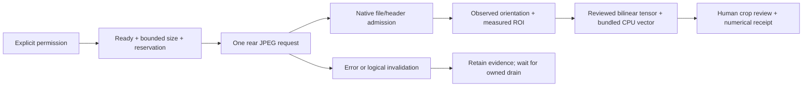

# P2-03 isolated camera review packet

2026-10-14. **Draft proposal for coordinator/founder review; document preparation
only. No camera security boundary, source change, build or phone execution approved
by this packet.** P2-01/02 generated preparation is independently accepted. P1
physical offline/result review remains founder-deferred because the phone supplies
laptop internet. The first implementation gate therefore remains closed.

Decision requested: after P1 closes, approve or amend one rear-camera proof using
installed Expo Camera, the existing bundled CPU model and separately bound camera
evidence. It must establish geometry and ownership before guided enrollment or
multi-frame scanning. DF-004 still defers the final advanced-recognition camera
provider; no new decision is entered here. Business data/RecognitionService/core
barcode scanning and the ordinary app variants remain outside this experiment.

## 1. Evidence and current facts

`observed-source` means the installed/repository implementation was read; it does
not mean the behavior was executed on a phone. `reviewed-report` identifies an
accepted earlier report. All behavior below a proposed gate is `proposal` until
separately approved. The assigned a2 inspection receipt binds these files' hashes.

| ID | Concrete source | Narrow fact supported |
| --- | --- | --- |
| S1 | [app config](</C:/Users/doyew/Documents/DEV 2/COSI-m8-planning/apps/mobile/app.config.ts:49>), [native plugin](</C:/Users/doyew/Documents/DEV 2/COSI-m8-planning/apps/mobile/plugins/withRecognitionExperiment.js>) | Recognition opt-in/environment must match; portrait UI; CAMERA/INTERNET/audio/media/location permissions blocked. Plugin excludes expo-camera, dev/updates/business-related modules; backup/cleartext disabled and optional startup/profile providers removed. |
| S2 | [installed camera version](</C:/Users/doyew/Documents/DEV 2/COSI-m8-planning/node_modules/expo-camera/package.json:3>), [mobile dependencies](</C:/Users/doyew/Documents/DEV 2/COSI-m8-planning/apps/mobile/package.json>) | Installed expo-camera57.0.6; app Expo57.0.22/RN0.86.3. No new camera package needed merely to attempt this route. |
| S3 | [CameraView](</C:/Users/doyew/Documents/DEV 2/COSI-m8-planning/node_modules/expo-camera/src/CameraView.tsx:181>), [types](</C:/Users/doyew/Documents/DEV 2/COSI-m8-planning/node_modules/expo-camera/src/Camera.types.ts>), [permission hook](</C:/Users/doyew/Documents/DEV 2/COSI-m8-planning/node_modules/expo-camera/src/index.ts:37>) | Readiness/error callbacks, permission methods, available picture sizes and takePictureAsync exist. pictureSize takes precedence over ratio according to types. active is documented for iOS, so it is not the proposed Android stop mechanism. onPictureSaved enables fastMode. |
| S4 | [Android view](</C:/Users/doyew/Documents/DEV 2/COSI-m8-planning/node_modules/expo-camera/android/src/main/java/expo/modules/camera/ExpoCameraView.kt:281>) | Capture bytes copied from ImageProxy, proxy closed, coroutine resolves/writes image. Orientation listener changes targetRotation. Separate preview/capture/analysis use cases bind without an explicit ViewPort in this method. Picture resolution fallback is CLOSEST_LOWER_THEN_HIGHER. zoom0 maps to a minimum1x request. Ready event means camera state OPEN. |
| S5 | [JPEG resolver](</C:/Users/doyew/Documents/DEV 2/COSI-m8-planning/node_modules/expo-camera/android/src/main/java/expo/modules/camera/tasks/ResolveTakenPicture.kt:185>), [options](</C:/Users/doyew/Documents/DEV 2/COSI-m8-planning/node_modules/expo-camera/android/src/main/java/expo/modules/camera/Options.kt>), [cache file helper](</C:/Users/doyew/Documents/DEV 2/COSI-m8-planning/node_modules/expo-camera/android/src/main/java/expo/modules/camera/utils/FileSystemUtils.kt>) | skipProcessing writes original JPEG bytes to UUID cache files and reports EXIF dimensions with default-1. Ordinary processing decodes and recompresses; with exif=true it does not take the same rotation branch as exif=false. Native maxDownsampling defaults1. Returned/raw orientation is not inferred from a JS documentation sentence. |
| S6 | [camera Gradle](</C:/Users/doyew/Documents/DEV 2/COSI-m8-planning/node_modules/expo-camera/android/build.gradle>), [manifest](</C:/Users/doyew/Documents/DEV 2/COSI-m8-planning/node_modules/expo-camera/android/src/main/AndroidManifest.xml>), [plugin](</C:/Users/doyew/Documents/DEV 2/COSI-m8-planning/node_modules/expo-camera/plugin/src/withCamera.ts>), [module declaration](</C:/Users/doyew/Documents/DEV 2/COSI-m8-planning/node_modules/expo-camera/expo-module.config.json>) | CameraX1.6.0 core/camera2/lifecycle/video/view/extensions; Exif1.4.2, AppCompat1.7.1/core-ktx1.18.0; listenablefuture1.0 force. Barcode flagfalse changes three barcode dependencies to compileOnly; CAMERA and ML Kit barcode_ui metadata remain in the library manifest. Declared native module is CameraViewModule/ExpoCamera. |
| S7 | [camera module](</C:/Users/doyew/Documents/DEV 2/COSI-m8-planning/node_modules/expo-camera/android/src/main/java/expo/modules/camera/CameraViewModule.kt:430>), [availability helper](</C:/Users/doyew/Documents/DEV 2/COSI-m8-planning/node_modules/expo-camera/android/src/main/java/expo/modules/camera/utils/CameraUtils.kt>) | Barcode methods/classes remain referenced in source; class availability checks gate some calls. View destruction cancels coroutine scope and unbinds camera. This does not prove every in-flight Promise settles or every resource drains. Emulator path manufactures an image, so emulator success cannot accept physical capture. |
| S8 | [recognition adapter](</C:/Users/doyew/Documents/DEV 2/COSI-m8-planning/apps/mobile/src/recognitionExperiment/nativeAdapter.ts>), [native module](</C:/Users/doyew/Documents/DEV 2/COSI-m8-planning/apps/mobile/recognition-native/recognition-experiment/android/src/main/java/expo/modules/recognitionexperiment/RecognitionExperimentModule.kt>), [module declaration](</C:/Users/doyew/Documents/DEV 2/COSI-m8-planning/apps/mobile/recognition-native/recognition-experiment/expo-module.config.json>) | Fixed generated/private requests with busy ownership and native single worker; no general live-camera URI/tensor ingestion API. Existing document callbacks own picker results rather than accepting caller document URIs. OnDestroy drains worker shutdown without claiming interpreter preemption. |
| S9 | [pixel geometry](</C:/Users/doyew/Documents/DEV 2/COSI-m8-planning/apps/mobile/recognition-native/recognition-experiment/android/cpu-runtime/src/main/java/expo/modules/recognitioncpu/GeneratedImageGeometry.java>), [sampled tensor kernel](</C:/Users/doyew/Documents/DEV 2/COSI-m8-planning/apps/mobile/recognition-native/recognition-experiment/android/cpu-runtime/src/main/java/expo/modules/recognitioncpu/PhonePortabilityImage.java>), [private replay](</C:/Users/doyew/Documents/DEV 2/COSI-m8-planning/apps/mobile/recognition-native/recognition-experiment/android/cpu-runtime/src/main/java/expo/modules/recognitioncpu/PhonePortabilityReplay.java>) | Existing EXIF1–8 inverse sampling, upright effective box, pixel-center uint8 bilinear, gray128 letterbox224x224, float32 RGB/div255. Generated full-image helper is bounded512 sides; private sampler has a larger pixel bound. Neither is a ready-made4MP camera admission adapter. |
| S10 | [CPU probe](</C:/Users/doyew/Documents/DEV 2/COSI-m8-planning/apps/mobile/recognition-native/recognition-experiment/android/cpu-runtime/src/main/java/expo/modules/recognitioncpu/GeneratedProbeCpu.java>), [CPU Gradle](</C:/Users/doyew/Documents/DEV 2/COSI-m8-planning/apps/mobile/recognition-native/recognition-experiment/android/cpu-runtime/build.gradle>) | Bundled MobileNet asset,1024 output components, CPU FROM_APPLICATION_ONLY,1 thread, XNNPACKfalse; LiteRT2.2.0 with ai-delivery exclusion. Public probe accepts fixture IDs, not arbitrary camera tensors. |
| S11 | [session](</C:/Users/doyew/Documents/DEV 2/COSI-m8-planning/apps/recognition-lab/src/phoneCapture/session.ts:7>), [enrollment](</C:/Users/doyew/Documents/DEV 2/COSI-m8-planning/apps/recognition-lab/src/phoneCapture/enrollment.ts>), [generated store](</C:/Users/doyew/Documents/DEV 2/COSI-m8-planning/apps/recognition-lab/src/phoneCapture/store.ts>) | Portable binding/Resource ownership, max3 attempts/400ms gap/3000ms deadline; logical cancellation never frees an owned job. Reopened trial preserves observed frames after C1. Store is Node-only disposable generated persistence, not an Android storage implementation. |
| S12 | [P1 C2 audit](</C:/Users/doyew/Documents/DEV 2/COSI-m8-planning/docs/recognition/reports/PHONE_P1_OFFLINE_GATE_C2_INDEPENDENT_AUDIT_20261014.md:33>), [P2 intake](</C:/Users/doyew/Documents/DEV 2/COSI-m8-planning/docs/recognition/PHONE_P2_PREPARATION_BRIEF_20261014.md:15>), [comparator](</C:/Users/doyew/Documents/DEV 2/COSI-m8-planning/tools/scripts/phone-portability-compare.py:83>) | Reviewed static APK closure had zero platform permissions,15 native libraries and six recorded dependency graphs. Later intake reports C2 installed once and physical review pending. Comparator reads current PhonePortabilitySource/Pins. No phone state was checked in this task. |
| S13 | [parent proposal](</C:/Users/doyew/Documents/DEV 2/COSI-m8-planning/docs/recognition/PHONE_P2_PLAN_20261014.md>), [recognition decisions](</C:/Users/doyew/Documents/DEV 2/COSI-m8-planning/docs/decisions/DECISION_LOG.md:1674>) | One-shot before enrollment/scans;80% guide/5% padding,4MP/12MiB and256MiB/115 proposals. Final advanced camera provider remains deferred. |

The exact current camera-capable merged APK/module/provider closure is **unknown**:
the installed camera package is excluded from the reviewed recognition APK.
S6 lists direct dependencies, not a resolved transitive runtime graph. Existing
module declarations and manifest exclusions do not substitute for the new build's
generated registration list, merged manifest, DEX/JNI/native/assets inspection.

## 2. Recommended first vertical proof — proposal

Prefer installed Expo Camera's ordinary rear still API with **raw skipProcessing**,
then one reviewed native JPEG decode/orientation/ROI sampling path. It avoids an
unreviewed Expo decode/recompress followed by another decode. Request mode picture,
facing back, zoom0 (minimum1x request), mirrorfalse, flash/torch off. Query supported
JPEG sizes after readiness, select a positive reported WxH with product<=4,000,000,
and wait for readiness after configuration changes. Freeze that choice before
capture. A size fallback can exceed the request; actual admission still controls.

Use takePictureAsync with skipProcessing:true, base64:false, exif:true for observed
metadata, no additionalExif, onPictureSaved, fastMode or pictureRef. Quality is not
a compression guarantee on this raw path. Store only whitelisted numeric EXIF
orientation/dimensions in receipts, never arbitrary EXIF fields. This configuration
is a proposal, not a physically checked compatibility result.

| Installed alternative | Benefit | Material cost / decision |
| --- | --- | --- |
| Raw JPEG + one native pipeline | Preserves encoded capture and makes EXIF/recipe explicit; recommended | Raw dimensions may be missing/-1; geometry/Exif/header must be measured. SDK capture allocation precedes app admission. |
| Expo processed JPEG + native pipeline | May provide directly reported decoded dimensions | Expo already decoded/recompressed; exif changes rotation branch, additional memory/encoding effects require a different reviewed recipe. No automatic fallback to this route. |

If raw metadata or ownership is insufficient, stop/inconclusive and return the
specific evidence for review. A different provider/CameraX adapter would require a
new scoped decision and benchmark, not an automatic dependency addition.

One target/one job first; no gallery, matching result or automatic product acceptance
is needed to prove this chain. Native raw vector and normalized vector/hash/norm
are distinct receipt fields. Hash model bytes, source, recipe, JPEG, effective box
and tensor before result acceptance. All candidate numerical tolerances are frozen
before a separately authorized physical run. Do not reuse the generated-only P0
schema or claim native evidence has its provisional Pillow LANCZOS recipe.

## 3. Proposed change list and security/build boundary

All paths in this section are **future proposed allowlist**, not writable now.
Approval may narrow them after P1 review. Root is the existing COSI-m8-planning.

| File/module | Proposed minimal responsibility |
| --- | --- |
| apps/mobile/app.config.ts | Add an explicit camera-proof opt-in inside recognition-verification, require both existing recognition flags, permit only CAMERA for that opt-in; original recognition path keeps zero permissions. |
| apps/mobile/plugins/withRecognitionExperiment.js | Conditional allowlist of expo-camera only; keep all other exclusions, CPU/ABI/SDK/entry/signing/no-network protections. Apply camera barcode flagfalse and audiofalse; remove residual barcode metadata and prove merged result. |
| apps/mobile/src/recognitionExperiment/ExperimentRoot.tsx | Route explicit camera-proof mode to one isolated proof screen, prohibit concurrent generated/private operations. Ordinary app scanner entry is untouched. |
| new apps/mobile/src/recognitionExperiment/CameraProofPanel.tsx and cameraProof.ts | Permission/readiness, bounded capture request, job invalidation, strict receipt validation and human review. No timers for multi-frame acquisition yet. |
| apps/mobile/src/recognitionExperiment/nativeAdapter.ts | Narrow ticket-bound camera proof calls; do not expand existing private/generated methods to arbitrary files. |
| apps/mobile/recognition-native/recognition-experiment/android/src/main/java/expo/modules/recognitionexperiment/RecognitionExperimentModule.kt | Integrate one owned camera-ingest worker/ticket and teardown settlement; preserve previous operations/busy boundary. |
| new CPU-package CameraProofFrame.java, CameraProofStore.java, CameraProofCpu.java | Bounded app-owned JPEG admission/ROI/tensor, app-private journal/receipt, same reviewed model/runtime settings. Existing sampling kernel may be called read-only after4MP admission. New CPU adapter is necessary: current public probe only accepts frozen fixture IDs. |
| new camera proof tests / tools/scripts/phone-camera-proof-checks.py / dedicated source-pin and APK checks | Generated geometry/ingest/lifecycle/store regressions and truthful independent camera-source fingerprint. No replacement P1 pin. Freeze model/generated-target assets through a new reviewed task-owned build ledger. |

No package/lock/native dependency changes are the default proposal. Runtime resolution
may expose missing classes or new artifacts; that is a stop/review finding. Never
patch node_modules, enable wholesale autolinking or permit model delivery to obtain
a green build. Proposed future generated build files are task-owned outputs; final
dispatch must name exact assets, signing/toolchain inputs and change ceilings.

Permission: Android CAMERA runtime request only after an explanatory action. Denial
or permanent denial yields a retained non-capture result; no retry loop/settings
navigation without explicit action. No microphone, gallery/storage/media/location,
foreground service, INTERNET or ACCESS_NETWORK_STATE addition. Keep backup and
cleartext flagsfalse; audit extraction/backup rules, launcher/exported components,
providers, intent filters and URI grants. Only baseline-required launcher exposure
is allowed; no external intent/URI becomes a capture request. Flags alone are not
proof of every OS backup/transfer/privacy behavior.

New ingress is a security boundary: the camera URI returned to JS is untrusted on
entry to native processing. Proposed ticket-issued native ingest accepts only the
current job and a regular canonical UUID JPEG under this app's cache/Camera, refuses
content/http/foreign roots/traversal/symlinks/aliases/size changes and copies through
a bounded owned stream before decode. Bind opened-file identity/hash and request
generation; reject substitutions and duplicate tickets. The stock Expo API does
not cryptographically attest a URI to a particular sensor exposure. Trusted proof
UI callback provenance plus native path/ticket checks must therefore be explicitly
approved; if that boundary cannot be justified, a stricter native-owned capture
adapter is a separate review item. Do not represent directory membership as sensor
provenance or provide a general image/tensor import function.

Cache is temporary, not durable evidence. Commit to a distinct filesDir camera-proof
root with atomic metadata and hash-bound retained JPEG before a ready receipt.
No business SQLite/catalogue/outbox or shared media. Existing P1 stores/picker/export
formats stay separate. Numerical export omits JPEGs and private EXIF; reviewed
generated-target preview/JPEG evidence remains local. A picture export would need
an exact separately approved destination/packet; no image upload or default gallery
publication. Cleanup may remove only a verified current job's temporary file after
drain/retained commit, never failed/old/user evidence. No silent eviction.

## 4. Measurable geometry protocol — proposed acceptance hypotheses

The80%-width-and-height centered guide and5%-of-box padding are hypotheses from
S13, not measured truths. S9's generated aspect-fill mapping only proves that
specified math on its small synthetic inputs. S4 has separate use cases and no
explicit shared ViewPort; equal requested aspect ratio does not establish equal
preview/JPEG field of view. ratio4:3 or16:9 makes FIT_CENTER in installed Android
source; do not use aspect-fill math on that image without measuring the letterbox.

Initial supported UI layouts: portrait app, rear lens/minimum1x, (A) the measured
available portrait preview rectangle and (B) a fixed4:3 rectangle within that
portrait screen. No front camera/digital zoom/split-screen/free rotation UI.
For each layout, the later finite generated-target proof covers physical device
poses0/90/180/270 while recording observed JPEG EXIF and actual dimensions. Sensor
pose is not assumed equal to locked UI orientation. Unsupported layout/metadata
is explicit NOT_SUPPORTED/INCONCLUSIVE, not silently accepted.

Use a generated asymmetric board with numbered corner/edge fiducials, UP/LEFT cues,
colored borders and an internal grid. Its file/print dimensions and target hash
are frozen before the run. No private product is required. Record:

- Actual view rectangle in physical pixels, density, safe-area/window insets,
  layout ID, requested pictureSize/ratio/zoom, returned width/height, raw JPEG
  header WxH, decoded WxH, EXIF1–8 and observed upright WxH.
- A separately authorized generated-only preview screenshot with the guide visible,
  actual JPEG and effective crop. Its origin/time/layout/target are bound; if
  screenshot/fiducial measurements cannot be obtained reliably, geometry is
  inconclusive. A manual measurement artifact belongs to this diagnostic proof,
  not the eventual retailer flow. No new general screenshot/export API is implied.
- Independent landmark coordinates in preview and upright JPEG, annotation
  uncertainty and preview content extent. Do not fit a new transform to each failed
  capture and then report the original transform correct.

Candidate mapping when aspect-fill correspondence is measured: upright image
W,H, preview Pw,Ph, s=max(Pw/W,Ph/H), offsets=(sW-Pw)/2,(sH-Ph)/2. Invert the guide
edges[.1Pw,.1Ph,.9Pw,.9Ph] through that transform; add5% of mapped box width/height
once per side, floor minima/ceil maxima, clamp, save the final upright half-open
integer box. Apply observed EXIF inverse sampling once. FIT needs measured content
rect and s=min(...); black bars cannot be treated as image pixels. Unknown sensor
crop/distortion/stabilization is a mapping failure/unknown, not a guessed correction.

Freeze proposed physical tolerance before execution: landmark/guide registration
residual<=1% of upright JPEG width/height, with preview annotation uncertainty<=2
physical pixels and crop rounding<=1 source pixel per edge. Reviewer may tighten
or amend those hypotheses now. Pure transform oracle uses exact integers/explicit
rounding and numerical<=1e-12 where appropriate; it does not substitute for the
physical tolerance. Report every border/fiducial mismatch and uncertainty; no
geometry pass if the evidence is missing or uncertainty exceeds the threshold.

Validate all eight EXIF orientations in generated pixel tests, odd dimensions,
both content modes, aspect mismatch, clamping and already-padded boxes. Do not
call GeneratedImageGeometry's512-side API with a4MP camera image; use a separately
reviewed general-size transform/sampler with the4MP ingress bound. The camera recipe
names Android JPEG decoding, observed EXIF mapping, effective ROI, pixel-center
uint8 bilinear/gray128/224 RGB float32/div255. No Pillow LANCZOS equivalence claim.

## 5. Admission, storage and ownership — proposed bounds

Before every request: current permission + foreground + nonzero measured layout +
ready generation + selected reported size<=4,000,000 pixels + no owned job + reserved
capacity. A ready callback alone is insufficient. Disable repeated action while
owned. Return request/JPEG-available/decode/inference/receipt monotonic times
separately. Stock JS capture result exposes no verified sensor-exposure timestamp;
JPEG Promise resolution is an availability time, not physical exposure timing.
One-shot results cannot accept later400ms capture-gap or3000ms scan timing claims.

Admission before allocating the native bitmap: closed regular owned file, bytes>0
and<=12*1024*1024; bounded header parse/MIME JPEG, positive dimensions with64-bit
product<=4,000,000; observed EXIF valid and pixel/returned metadata consistent.
Requested size is not the observed size. Raw skipProcessing dimensions may be-1:
record that fact and refuse full readiness/mark inconclusive under this initial
policy. A header-only exception requires an explicit amended policy; never silently
fill unknown returned dimensions or switch to processed JPEG. Malformed/trailing
vendor containers, PNG, unsupported orientation, oversized or changed files produce
retained refusal. Review the exact accepted JPEG/container policy before coding.

Decode without implicit sampling, verify MIME/dimensions/config/actual allocation,
and release Bitmap in finally. Proposed allocation ceiling<=8 bytes per admitted
pixel (32,000,000 at4MP); sampler outputs224x224 and602112-byte float tensor, not
another full upright/crop bitmap. Camera SDK itself may already allocate image
buffers/ByteArrayOutputStream before our checks; these bounds govern admitted
processing, not a proven camera-wide memory ceiling. Measure actual peak memory.

Retained diagnostic limit: proposed256MiB total owned camera evidence+metadata+
uncommitted/cache/staging bytes, maximum115 capture records for later40refs+75query
attempts. 115*12MiB=1380MiB, so115 is a count ceiling, not guaranteed capacity.
Reserve24MiB for one12MiB SDK file plus12MiB owned copy before request, plus bounded
metadata allowance1MiB; also require device free-space headroom for that reservation.
With no residue,19 existing worst-size files permit a20th request; after20 retained
12MiB files the next request refuses. Failed stages/cache residue count and can
stop sooner. No compression/eviction/retake to make the declared run fit.

The capacity journal must bind reservations to job IDs and account across restart;
unacknowledged space remains held until verified recovery, not reset tozero.
Reserve failure-metadata space first so capacity refusal can be recorded. Persist
source/model/recipe/target/job bindings, input/tensor/vector hashes and ownership
states atomically; Android file/journal durability needs its own injected and
physical evidence. Node generated store is not reused as native persistence.
Default numerical export stays bounded independently; the parent's<=32KiB/product
gallery target is a later measured budget, not proof that JSON will fit.

Cancel/background/permission loss/unmount invalidates publication immediately,
signals cancellation once and keeps the job owned until actual capture I/O, native
worker and file handles drain. S7's scope cancellation/unbind can leave uncertain
Promise settlement; no timeout, pausePreview or unmount acknowledgement frees the
busy gate. Stale callbacks can clean only their own handle once, publish no vector
and touch no newer job. Decode/inference/write errors keep observed facts and a
terminal failure; no automatic retry. An unresponsive resource stays DRAINING and
blocks another request; report and stop the finite proof rather than forcing success.
Restart classifies interruption and preserves committed/partial facts without
recapture. Android process death, backing store and actual drain remain unproved.

## 6. Source/build/physical review sequence

| Gate | Required evidence and stop condition |
| --- | --- |
| G0 — review this document | Approve/amend exact future change list, ingress/permission/privacy boundary, raw recipe, geometry tolerance, storage policy and finite proof limits. No native effect yet. |
| G1 — P1 closure BEFORE implementation | Founder independent connectivity; previously authorized finite P1 diagnostics/replay/recovery/export and unchanged comparison reviewed. No new hotspot prompt, replay workaround, repin, reinstall or replacement APK from this packet. |
| G2 — scoped source/generated correction slice | After G0/G1 and new dispatch: pure JPEG bounds/geometry/refusals, no-query stale/cancel/drain tests, lifecycle ownership, reservation/recovery atomicity, receipt validation and ordinary-variant regressions. STOP/direct handoff before independent source audit. |
| G3 — separately approved exact local build/static APK | Fresh task-owned source/asset/dependency/toolchain/signature hashes; before/after Expo/RN generated registration, compile/runtime graphs, merged permissions/components/providers/metadata, DEX references/class-loader closure, assets/licenses, model/runtime/JNI/native ELF/16KB compatibility, package/min24/target36/arm64 and backup/cleartext rules. Every delta explained. No phone install from a source pass. |
| G4 — finite separately approved generated-target phone proof | Only after static APK acceptance: exact APK/hash/device/OS and connectivity policy, explicit install/run consent, permission denial/grant, one-shot chain, geometry matrix, stale/background/drain failure observations and local numerical receipt. Retain all failures; no retries or private products. |
| G5 — review outcome before another slice | Accept only scoped geometry/recipe/receipt/resource findings or classify fail/inconclusive. No live accuracy or speed acceptance. Narrow a new dispatch for guided enrollment/session if justified. |

G3 must confirm CAMERA is the only added platform permission, no INTERNET/audio/
gallery/business route, no new Play/GMS/MLKit runtime/class references or barcode_ui
delivery metadata unless an explicit reviewed exception is proposed. compileOnly
and a disabled callback are insufficient evidence. CameraX video/extensions, Exif,
AppCompat/core and forced Guava interface are still real closure/build-size review
items. Missing registration dependencies or linkage failures stop the build review;
do not quietly add image-loader/asset/scanner/runtime modules. Inspect final
merged manifest and generated provider list; the inspected library manifest alone
cannot prove transitive providers absent. Keep ordinary barcode configuration exact.

Compare incremental installed size to the parent's50MiB guardrail and measured peak
memory to200MiB incremental budget using a compatible baseline; record APK/native/
asset deltas, not just file-size guesses. No new build/resolved graph was produced
today, so costs and no-network/module closure remain gates. Existing bundled model
hash/settings and CPU-only application runtime remain frozen; no new model/delegate.

Proposed first physical packet ceiling:10 generated-target captures, with no
automatic retakes. Establish one upright/layout-A full-chain capture before the
remaining orientation/layout cases (eight combinations total); reserve remaining
attempts only for explicitly declared lifecycle observations. Permission-denial/
capacity/malformed controls may be non-capture. A failure stops its chain and is
retained; it does not buy another attempt. A geometry mismatch or unresolved drain
can end the packet early. One-shot timings are descriptive; no median/p95/3s live
session acceptance follows from this count.

## 7. Preserve P1 and keep later slices bounded

P2 intake reports installed C2 APK SHA
`c7f04760381e7a3bedbff14084ec12b03c51229eb0e73660be0494a0d7afc48b` and current24-source
pin `cf0fc3c71d475336b849aa4b3b90c382f9e65a2ea4e8124f37cc21de6bf5610d`. The pin and24
current files were rechecked read-only for this packet; installed phone state was
not observed. Do not touch any of those24 source paths before P1 physical/result
review, including ExperimentRoot/nativeAdapter/module proposed above. Preserve
the installed APK, transferred C4 input, old runs, comparator and Source/Pins.

After P1 closes, snapshot its exact reviewed source/results before separately
approved camera edits. Create a distinct camera source/recipe/asset/target manifest;
do not reinterpret or rewrite the P1 source constant, private pin or old comparator
to make camera changes look like the old replay. The same isolated recognition
variant may serve the later proof after review; no second permanent app or package
is proposed. Installing its new APK is a separate effect after P1 closure.

P1 outcomes that can change this proposal: pixel/tensor mismatch changes recipe;
vector parity failure blocks camera model integration; native lifecycle/low-memory/
restart failures change ownership/reservation/durability work; offline-policy or
export/comparator findings change the execution/receipt gate. If they remain
unresolved, stay at documentation/generated planning rather than bypassing them.

Rolling scope only: P2-03 one-shot source/build/proof; P2-04 guided ordered enrollment
with Android durability after geometry/drain review; P2-05 bounded live sessions
and paired view arms after that. P3 OCR/specifications and P4 extra cue remain
conditional on residual evidence; P5 later confirmation/decision remains separately
frozen and approved. No universal classifier, new schemas/business integration or
speculative P2-toP5 implementation is dispatched. Full accuracy, unknown abstention,
holdout, live latency, M12 and release gates remain open.

Next review action: coordinator independently reviews this document and the exact
source-backed limits. Native implementation requires G0 approval **and** G1 closure
plus a fresh bounded dispatch. This draft grants none of those effects.
